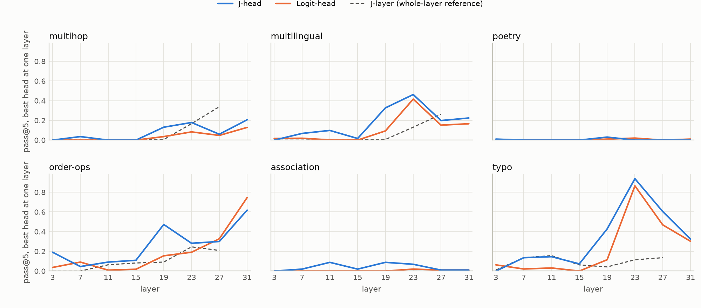
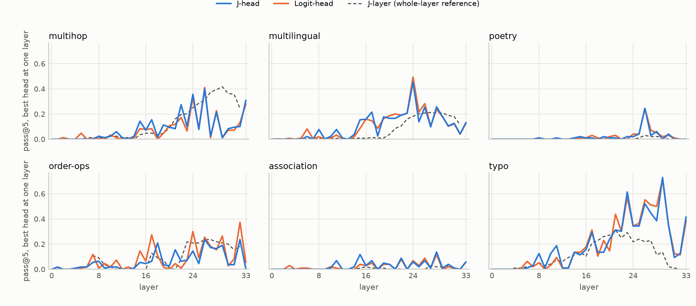
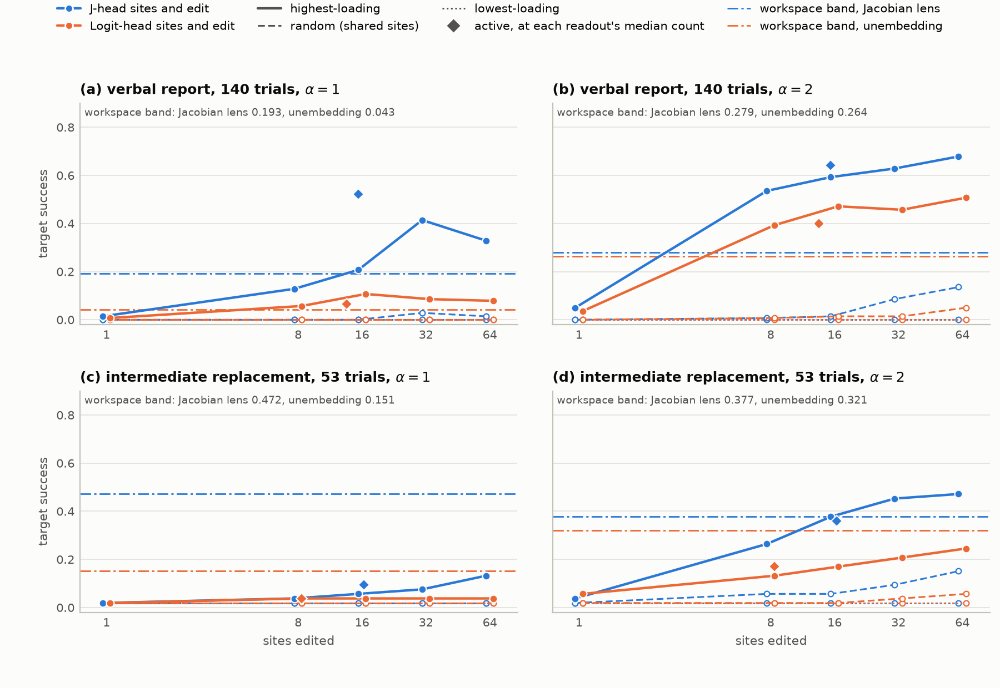
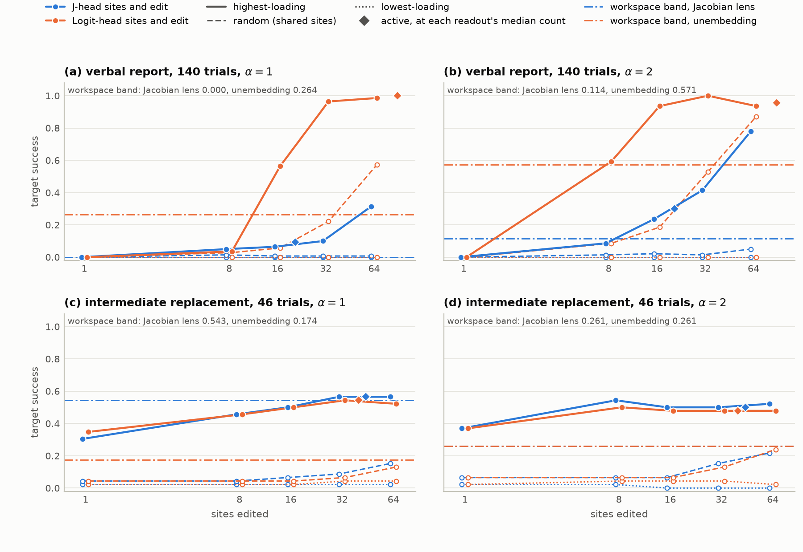

# Head-JLens on Qwen3.5-4B and Gemma-3-4B-IT

The [paper](head_jlens_paper.pdf) studies one checkpoint, Llama-3.1-8B-Instruct. The
same code also fits and evaluates Head-JLens on two smaller checkpoints, Qwen3.5-4B and
Gemma-3-4B-IT. This document explains how their lenses were fitted (Section 1) and what
the paper's two experiments give on them when re-run with the current code (Section 2).
Notation, estimator and experiments are the paper's; only what differs is described here.

## 1. How the lenses were fitted

### 1.1 What is fitted

For each layer $l$ that has attention heads, Head-JLens fits one matrix $J^z_l$: the
derivative of the last block's output $x_L$ with respect to the input of that layer's
attention output projection, $z_l$ (the heads' outputs, concatenated, before $W_O$ mixes
them). The derivative is summed over target positions and averaged over source positions
and prompts (paper, Section S1.2). Head $h$ is read through its own block of columns,
$J_{l,h} = J^z_l[:, \mathcal C_h]$. This is the same object as on Llama; what changes
between checkpoints is where $z_l$ exists and what lies between it and the residual
stream.

### 1.2 What is the same as on Llama

Both fits use the estimator, corpus and budget of the Llama lens, run by the same script
(`scripts/fit_lens.py`):

- **Prompts.** The same 1,000 WikiText-103 training passages as Llama: a seeded draw
  (seed 0) of 1,400 passages from the first 4,000 usable documents of the training split
  (at least 600 characters, no section headers, cut at 2,000 characters), of which the
  first 1,000 are used. Sampling code: [`src/corpus.py`](src/corpus.py).
- **Positions.** Each passage is tokenized to at most 128 tokens. Positions 0–15 and the
  final position are excluded as both sources and targets, which leaves 111 positions for
  a full-length passage.
- **Budget.** Fixed at 1,000 prompts, with no stopping rule. The relative change of the
  running mean is written to a trace after every prompt but never acted on.
- **Shards.** Four disjoint 250-prompt slices of the draw (offsets 0, 250, 500, 750), each
  on one NVIDIA A100 80 GB card, merged by a prompt-weighted mean
  ([`scripts/merge_jz.py`](scripts/merge_jz.py)). The merge refuses overlapping slices,
  slices from different draws, and shard files whose digest no longer matches their
  sidecar.
- **Precision.** Forward and backward passes in bfloat16, derivatives accumulated in
  float32, matrices saved in float16. No `torch.compile`, which would bypass the hook on
  `o_proj`'s input.

### 1.3 What had to change

|                                    | Qwen3.5-4B                                          | Gemma-3-4B-IT                                                  |
| ---------------------------------- | --------------------------------------------------- | -------------------------------------------------------------- |
| Blocks                             | 32: 8 softmax attention, 24 Gated DeltaNet          | 34 softmax attention (29 sliding-window, 5 global)             |
| Layers fitted                      | 8 ($l = 3, 7, \dots, 31$)                           | 34 ($l = 0, \dots, 33$)                                        |
| Heads × head width = $d_{\text{src}}$ | $16 \times 256 = 4096$                           | $8 \times 256 = 2048$                                          |
| $d_{\text{model}}$                 | 2560                                                | 2560                                                           |
| Head sites                         | 128                                                 | 272                                                            |
| What $z_l$ is                      | attention result times a sigmoid gate               | attention result                                               |
| Between $W_O$ and the residual add | nothing                                             | an RMSNorm                                                     |
| Output dimensions per backward pass | 32                                                 | 64 (as Llama)                                                  |
| Top-layer check against            | $W_O$                                               | $\mathrm{diag}(g_{\text{post}})\,W_O$                          |

All of these are recorded per checkpoint in its `LensSpec`
([`src/config.py`](src/config.py)) and checked against the loaded model before anything
runs.

**Qwen: heads exist in a quarter of the blocks.** Qwen3.5 is a hybrid: every fourth
block is softmax attention and the rest are Gated DeltaNet blocks, which have no output
projection and no heads in the paper's sense. $J^z_l$ is therefore fitted at the eight
attention blocks only, and the head grid has $8 \times 16 = 128$ sites. The DeltaNet
blocks still lie between those heads and the output, and the derivative passes through
them. In Qwen's attention blocks the attention result is multiplied by a sigmoid gate
before $W_O$. The anchor is taken after the gate, since that is the vector $W_O$
consumes, so a head's slice of $z_l$ and its write $W_O^{(h)} z_{l,h}$ are defined exactly
as on Llama.

**Gemma: a normalization after $W_O$.** Gemma-3 normalizes the attention output before
adding it to the residual stream:
$x^{\text{mid}}_l = x_l + \mathrm{RMSNorm}_{\text{post}}(W_O z_l)$. Nothing changes in
how the fit is run, since the hook sits at $z_l$ and the derivative goes through the
normalization like any other part of the network. What changes is what the fitted map
contains. On Llama, $J^z_l = J^{\text{attn}}_l W_O$ (paper, Section S1.1): the head map is
the residual-stream map times a fixed matrix. On Gemma the normalization's derivative
depends on the input, so the averaged $J^z_l$ does not factor that way. It already
includes the normalization, averaged over the corpus. The per-head readouts still add up
exactly, $\sum_h J_{l,h} z_{l,h} = J^z_l z_l$, because the fitted map is linear.

**Loading.** Both checkpoints are released as multimodal models. Only the language model
is used, and its layer count, head count, head width and block types are read from the
text configuration. Before fitting, the loader checks that the blocks with an `o_proj` are
exactly the layers to be fitted, that every `o_proj` has no bias and has shape
$d_{\text{model}} \times d_{\text{src}}$, and that a normalization sits between `o_proj`
and the residual add on Gemma and nowhere else. Qwen's tokenizer has no beginning-of-sequence
token and adds none; Gemma's prepends one, as Llama's does.

**Output dimensions per backward pass.** Each backward pass differentiates a batch of
output coordinates of $x_L$. Qwen's DeltaNet blocks run transformers' pure-PyTorch
implementation, whose retained graph does not fit on an 80 GB card at 64 coordinates per
pass, so the Qwen fit used 32. This sets memory and run time, not the estimate.

### 1.4 Checks

**Top-layer check.** At the top fitted layer only that block's MLP separates $z_l$ from
$x_L$, so $J^z_l$ should point the same way, row by row, as the matrix the block adds to
the residual stream per unit of $z_l$. That matrix is $W_O$ on Qwen and
$\mathrm{diag}(g_{\text{post}})\,W_O$ on Gemma, where $g_{\text{post}}$ is the gain of the
post-attention normalization. Each shard must reach a median row cosine above 0.8. On
Llama the check also requires a median row cosine below 0.1 against the identity, which
is what a hook slipped to `o_proj`'s output would produce. That second arm needs a square
$W_O$, and neither model has one. A slipped hook would instead score near zero against
the reference. This is a sanity check on the hook's placement, not a proof that the fit is
right.

| checkpoint | layer | reference | median row cosine, each shard | after the first prompt |
| --- | ---: | --- | --- | --- |
| Qwen3.5-4B | 31 | $W_O$ | 0.904, 0.904, 0.904, 0.904 | 0.89–0.90 |
| Gemma-3-4B-IT | 33 | $\mathrm{diag}(g_{\text{post}})\,W_O$ | 0.990, 0.990, 0.990, 0.990 | 0.987–0.988 |

All eight shards pass. Llama's four shards score 0.867.

**Digests.** Each shard's sidecar records its file's sha256, and the merge sidecar
records the merged file's. The merged digests are pinned in `LensSpec.jz_digests`, and
every driver refuses a lens whose bytes do not match, whether it was fitted locally or
downloaded from the Hub.

### 1.5 The fits

|                               | Qwen3.5-4B              | Gemma-3-4B-IT           |
| ----------------------------- | ----------------------- | ----------------------- |
| Finished                      | 2026-09-15              | 2026-09-16              |
| Prompts fitted / skipped      | 1,000 / 0               | 1,000 / 0               |
| Time per prompt               | 81 s                    | 22 s                    |
| Time per 250-prompt shard     | 5.6 h                   | 1.5 h                   |
| Total                         | 22.5 GPU-hours          | 6.2 GPU-hours           |
| Merged lens                   | 8 × (2560 × 4096), 168 MB | 34 × (2560 × 2048), 357 MB |
| sha256                        | `249929f2…`             | `5c9f6f12…`             |

For comparison, the Llama fit took about 15 GPU-hours. Qwen is about four times slower
per prompt than Gemma because it runs twice as many backward passes (80 rather than 40
for $d_{\text{model}} = 2560$) through the unfused DeltaNet code. Both fits
ran with torch 2.13.0 (CUDA 13.0) and transformers 5.15.0. Since then the fitting code
has changed only in comments and in the recorded digests.

**Where everything is.**

- Lenses: [`fmerlo/head-level-jlens`](https://huggingface.co/fmerlo/head-level-jlens) on
  the Hub, as `qwen3.5-4b_Jzfit_n1000.pt` and `gemma-3-4b-it_Jzfit_n1000.pt`. They
  download on first use.
- Fit records: `results/fit/<key>_a{0,1,2,3}_fit.json` (settings, prompt counts, shard
  digest, top-layer check), `results/fit/<key>_a{0,1,2,3}_convergence.csv` (one row per
  prompt: length, valid positions, time, top-layer cosine, change in the running mean)
  and `results/fit/<key>_merge.json` (which shards, which slices, merged digest), with
  `<key>` one of `qwen3.5-4b` and `gemma-3-4b-it`.

**Fitting again.** The README's fit commands take `--lens`:

```bash
for i in 0 1 2 3; do
  uv run python -m scripts.fit_lens --lens qwen3.5-4b --gpu $i --n-prompts 250 \
      --prompt-offset $((i * 250)) --shard a$i &
done; wait
uv run python -m scripts.merge_jz --lens qwen3.5-4b --shards a0 a1 a2 a3
```

`--dim-batch` defaults to the checkpoint's setting. `scripts.pipeline --stages fit` runs
the same shards and merge over a pool of GPUs.

## 2. Results with the current pipeline

Both checkpoints were re-run on 2026-10-12 with the paper's protocol, on the pinned
lenses above: Experiment 1 (`scripts.read`), the J-head against Logit-head coordinate
swap of Experiment 2 (`scripts.write_swap_sites`, three shards, then
`scripts.report_swap_sites`), the J-head-only edit run (`scripts.write`), the report and
the figures. The runs took 24 minutes on four A100 80 GB cards:

```bash
setsid nohup uv run python -m scripts.pipeline \
    --models qwen3.5-4b gemma-3-4b-it --gpus 0 1 2 3 --stages eval \
    > logs/pipeline/pipeline.out 2>&1 < /dev/null &
```

Experiment 1 reproduces the September records exactly (every rate and every raw rank).
The swap records are new: the September runs predate the paper's clamped swap and its
Logit-head arm.

### 2.1 What differs from the Llama runs

- **Search size.** Each head readout searches 128 sites on Qwen and 272 on Gemma,
  against 1,024 on Llama. Sixty-four sites are half of Qwen's grid, so a random 64-site
  set shares 32 sites with the selected set on average.
- **J-layer reference.** Neuronpedia's layer-output Jacobian lenses, as released: 417
  prompts and block outputs 0–30 on Qwen (DeltaNet blocks included), 546 prompts and
  block outputs 0–32 on Gemma.
- **Logit-head on Gemma** decodes $\mathrm{diag}(g_{\text{post}})\,W_O^{(h)} z_{l,h}$, the
  head's write scaled by the gain of the post-attention normalization. Normalizing the
  head's write on its own gives this vector up to a positive factor, which the final
  normalization removes. On Llama and Qwen Logit-head decodes $W_O^{(h)} z_{l,h}$.
- **Workspace band.** The layer-wide reference uses the band of Gurnee et al. (their
  38–92% depth range), which is block outputs 12–28 on Qwen and 13–30 on Gemma.
- **Candidate coverage.** Both tokenizers split numerals into digits, and the multihop
  and order-ops sets score single-token candidates only. Nine multihop intermediates
  (26, 14, 11, 16, 13, 12, 52, 50, 12) and one order-ops intermediate (24) have no
  candidate. Each of the nine is its item's only intermediate, so multihop is scored on
  84 of 93 items. Order-ops keeps all 55 items. The other four sets are complete.
- **Trials.** Intermediate replacement keeps the items each model answers correctly
  before any edit: 53 on Qwen, 46 on Gemma, 45 on Llama. Verbal report has 140 trials on
  each model.

Section 2.5 lists what limits the comparison beyond these differences.

### 2.2 Experiment 1: reading heads

**Table 1.** All-layer pass@1, J-head / Logit-head / J-layer, and the paired J-head minus
Logit-head difference.

| Set | Qwen | Qwen, paired difference | Gemma | Gemma, paired difference |
| --- | --- | ---: | --- | ---: |
| multihop | 0.179 / 0.113 / 0.161 | +0.065 | 0.548 / 0.565 / 0.345 | −0.018 |
| multilingual | 0.397 / 0.290 / 0.178 | +0.107 | 0.694 / 0.745 / 0.227 | −0.051 |
| poetry | 0.010 / 0.010 / 0.000 | +0.000 | 0.204 / 0.194 / 0.010 | +0.010 |
| order-ops | 0.655 / 0.545 / 0.173 | +0.109 | 0.455 / 0.500 / 0.309 | −0.045 |
| association | 0.088 / 0.020 / 0.000 | +0.069 | 0.216 / 0.176 / 0.010 | +0.039 |
| typo | 0.938 / 0.781 / 0.208 | +0.156 | 0.958 / 0.969 / 0.312 | −0.010 |

**Table 2.** Paired J-head minus Logit-head difference, all layers, on the three
checkpoints. The Llama values are the paper's (Tables 1 and S2).

| Set | pass@1: Llama | Qwen | Gemma | pass@5: Llama | Qwen | Gemma |
| --- | ---: | ---: | ---: | ---: | ---: | ---: |
| multihop | +0.143 | +0.065 | −0.018 | +0.116 | +0.244 | −0.073 |
| multilingual | +0.028 | +0.107 | −0.051 | +0.009 | +0.112 | −0.016 |
| poetry | −0.051 | +0.000 | +0.010 | −0.092 | +0.000 | −0.041 |
| order-ops | +0.082 | +0.109 | −0.045 | +0.100 | +0.018 | −0.073 |
| association | +0.029 | +0.069 | +0.039 | +0.069 | +0.147 | +0.020 |
| typo | +0.000 | +0.156 | −0.010 | +0.000 | +0.073 | +0.000 |

**Qwen.** J-head recovers more annotated intermediates than Logit-head on five of six
sets at pass@1, by +0.065 (multihop) to +0.156 (typo). On poetry both are at
0.010. At pass@5 the largest differences are on multihop (+0.244) and association
(+0.147), larger than Llama's on those sets. J-layer is below J-head on every set. By
layer (Figure 1), J-head is at or above Logit-head at most layers on every set except
poetry, where both stay near zero. On order-ops Logit-head is higher at layers 7, 27
and 31.

**Gemma.** The two head readouts are close. At pass@1 Logit-head is ahead on four sets,
by at most 0.051 (multilingual), and J-head on association (+0.039) and poetry (+0.010).
At pass@5 Logit-head leads on four sets, by up to 0.073 (multihop and order-ops). J-head
leads on association (+0.020), and typo ties. By layer (Figure 2), the two curves follow
each other closely. J-layer is below both head readouts on every set.

Heads write a median 6.9% of the residual stream they join on Qwen and 1.4% on Gemma
(3.9% on Llama). As in the paper, these rates describe the direction of a head's write,
not its size.



**Figure 1.** Qwen per-layer pass@5 at its eight attention layers, best of 16 heads per
layer. J-layer covers block outputs 0–30.



**Figure 2.** Gemma per-layer pass@5, best of 8 heads per layer. J-layer covers block
outputs 0–32.

### 2.3 Experiment 2: coordinate swap

Tables 3 and 4 follow the paper's Table 2. Entries are successes, J-head / Logit-head.
Each readout edits its own highest-loading, lowest-loading or active sites. Random sites
are shared. "Random direction" is a same-norm random update at each readout's own 64
sites. The layer-wide reference swaps the whole residual stream over the workspace band,
through the Jacobian lens / the bare unembedding. Update norms are mean total head-level
norms.

**Table 3.** Qwen.

| Sites | Verbal report, $\alpha=1$ (of 140) | Verbal report, $\alpha=2$ (of 140) | Intermediate replacement, $\alpha=1$ (of 53) | Intermediate replacement, $\alpha=2$ (of 53) |
| --- | ---: | ---: | ---: | ---: |
| 1 | 2 / 1 | 7 / 5 | 1 / 1 | 2 / 3 |
| 8 | 18 / 8 | 75 / 55 | 2 / 2 | 14 / 7 |
| 16 | 29 / 15 | 83 / 66 | 3 / 2 | 20 / 9 |
| 32 | 58 / 12 | 88 / 64 | 4 / 2 | 24 / 11 |
| 64 | 46 / 11 | 95 / 71 | 7 / 2 | 25 / 13 |
| active | 73 / 9 | 90 / 56 | 5 / 2 | 19 / 9 |
| median active sites | 16 / 13 | 16 / 13 | 17 / 8 | 17 / 8 |
| *Controls and reference* | | | | |
| 64 random sites | 2 / 0 | 19 / 7 | 1 / 1 | 8 / 3 |
| 64 lowest-loading | 0 / 0 | 0 / 0 | 1 / 1 | 1 / 1 |
| 64, random direction | 0 / 0 | 0 / 0 | 1 / 1 | 1 / 1 |
| layer-wide, block outputs 12–28 | 27 / 6 | 39 / 37 | 25 / 8 | 20 / 17 |
| update norm, 64 sites | 18.1 / 18.7 | 36.3 / 37.5 | 11.7 / 12.2 | 23.2 / 24.4 |

**Table 4.** Gemma.

| Sites | Verbal report, $\alpha=1$ (of 140) | Verbal report, $\alpha=2$ (of 140) | Intermediate replacement, $\alpha=1$ (of 46) | Intermediate replacement, $\alpha=2$ (of 46) |
| --- | ---: | ---: | ---: | ---: |
| 1 | 0 / 0 | 0 / 0 | 14 / 16 | 17 / 17 |
| 8 | 7 / 5 | 12 / 83 | 21 / 21 | 25 / 23 |
| 16 | 9 / 79 | 33 / 131 | 23 / 23 | 23 / 22 |
| 32 | 14 / 135 | 58 / 140 | 26 / 25 | 23 / 22 |
| 64 | 44 / 138 | 109 / 131 | 26 / 24 | 24 / 22 |
| active | 13 / 140 | 42 / 134 | 26 / 25 | 23 / 22 |
| median active sites | 21.5 / 86 | 21.5 / 86 | 46 / 38.5 | 46 / 38.5 |
| *Controls and reference* | | | | |
| 64 random sites | 1 / 80 | 7 / 122 | 7 / 6 | 10 / 11 |
| 64 lowest-loading | 0 / 0 | 0 / 0 | 1 / 2 | 0 / 1 |
| 64, random direction | 0 / 0 | 0 / 0 | 1 / 1 | 1 / 1 |
| layer-wide, block outputs 13–30 | 0 / 37 | 16 / 80 | 25 / 8 | 12 / 12 |
| update norm, 64 sites | 200.5 / 649.5 | 400.8 / 1309.7 | 80.3 / 117.5 | 160.3 / 234.4 |

**Qwen.** On verbal report J-head succeeds more often than Logit-head at every count, at
both strengths. At $\alpha=1$ it reaches 58/140 against 12/140 at 32 sites and 73/140
against 9/140 at the active sets. The band reference reaches 27/140 through the Jacobian
lens and 6/140 through the bare unembedding. On intermediate replacement, head edits at
$\alpha=1$ change few answers: at most 7/53 for J-head and 2/53 for Logit-head, each
including the trial that succeeds without an edit. The band reference reaches 25/53 there.
At $\alpha=2$ J-head leads from eight sites up, 14/53 against 7/53 at eight sites and
25/53 against 13/53 at 64. Unlike Llama, the two readouts' update norms are about equal
at 64 sites (18.1 against 18.7 on verbal report at $\alpha=1$; Llama 5.6 against 10.1).
J-head's lead here does not come with larger updates. At $\alpha=1$ the count-matched
controls reach at most 4/140 (32 random sites) and 1/53 (the trial that succeeds without
an edit). At $\alpha=2$ the 64 random sites reach 19/140 under the J-head edit, where they
overlap the selected set by half.

**Gemma.** On intermediate replacement the two readouts tie. At $\alpha=1$ they reach
14/46 against 16/46 at one site, 21/46 each at eight and 26/46 against 24/46 at 64.
J-head's updates are smaller at every count (80 against 118 at 64). One selected site
already succeeds on 14/46 trials, against none on Llama. At $\alpha=1$, random and
lowest-loading sites reach at most 7/46 and 2/46, and the band reference reaches 25/46
through the Jacobian lens and 8/46 through the bare unembedding. On verbal report
Logit-head reaches 135/140 at 32 sites and 140/140 at its active sets, against 14/140
and 13/140 for J-head ($\alpha=1$).
That gap does not come from site choice. Logit-head's updates on these trials are 3 to 38
times J-head's at matched counts (467 against 29 at eight sites). At 64 sites they move
the output distribution by a KL of 19.1 nats from the clean run, against 2.0 for J-head.
They also succeed at the shared random sites, 80/140 at 64, where J-head's succeed on
1/140 (Section 2.5).



**Figure 3.** Qwen target-token success by edited-site count, as the paper's Figure 4.
Blue is J-head and orange is Logit-head. Solid lines are each readout's highest-loading
sites, dashed shared random sites, dotted lowest-loading sites. Diamonds are active sets
at their median counts. Dash-dotted lines are the layer-wide swap over block outputs
12–28.



**Figure 4.** Gemma, as Figure 3, with the layer-wide swap over block outputs 13–30.

### 2.4 Across the three checkpoints

- **Reading.** J-head's advantage over Logit-head carries over to Qwen, where it is
  larger than on Llama on most sets, but not to Gemma, where the two readouts are about
  even and Logit-head is slightly ahead on most sets.
- **Editing.** On Qwen, J-head's highest-loading sites change the output more often than
  Logit-head's at similar update norms. On Gemma the two tie on intermediate replacement,
  with smaller J-head updates. On both new models, verbal report swaps out a
  non-category answer token, so it does not repeat the paper's test (Section 2.5).

### 2.5 Limitations

- **Verbal report does not test a concept swap on these models.** On the raw prompt
  neither model answers with a member of the category: Qwen answers `What`, a newline or
  two newlines, and Gemma always two newlines, so 0 of 140 trials start from an in-class
  answer (130 of 140 on Llama). The swap's source direction is that answer token. On these
  two models the task therefore measures whether an edit can make a chosen category
  member the top token, not whether it changes a reported concept, and its rates are not
  comparable with the paper's verbal-report results.
- **Numeric answers are scored by their first token.** A swap succeeds when the model's
  top token is the first token of the target answer, spelled with or without a leading
  space. Qwen's and Gemma's tokenizers split numerals into digits, so for a numeric
  answer that token is its first digit. One intermediate-replacement trial
  (`chem-bones-Z`: calcium, 20, swapped to iron, 26) therefore succeeds before any edit
  and adds one success to every intermediate-replacement cell on both models, controls
  included. Paired J-head minus Logit-head differences are unchanged, since the trial
  counts for both readouts. Separately, the spaced spelling of a numeral (`" 26"`) begins
  with a bare space token on all three tokenizers, Llama's included, so the space token
  is in the success set of 9 Qwen, 6 Gemma and 7 Llama trials. No success in the swap
  records of any of the three checkpoints came through it. The scoring rule in the code
  is unchanged.
- **Gemma's verbal-report comparison is dominated by update size.** Logit-head's lead
  (135/140 against 14/140 at 32 sites, $\alpha=1$) comes with updates 3 to 38 times
  J-head's at matched counts and a KL of 19.1 nats from the clean run at 64 sites
  (J-head 2.0). Its edits at the shared random sites succeed on 80/140 trials, against
  1/140 for J-head's. Update norms were not equalized, so this lead does not show that
  Logit-head selects better sites or directions. Why the Logit-head coordinates are this
  large on these trials has not been examined.
- **Causes are not identified across checkpoints.** Architecture, tokenizer, scored
  items, trial sets and search size all change together between checkpoints, so these
  runs do not say which of them causes the differences.

### 2.6 Records

With `<key>` one of `qwen3.5-4b` and `gemma-3-4b-it`:

- `results/read/<key>_read.json`: Experiment 1, with candidate coverage in its `meta`.
- `results/write_swap_sites_clamp/<key>/`: the swap shards, `summary.md` (every count,
  both strengths, all selection × edit combinations, KL, update norms) and
  `summary.json`.
- `results/write/<key>_write.json`: the J-head-only edit run with its matched-norm
  direction control.
- `results/report/<key>_report.md`: pass@1, 5 and 25, per-layer ratios, best-site
  agreement and the J-head-only edit tables.
- `results/figures/<key>/`: the paper's figures for this checkpoint.

The raw rank and swap arrays (`*.npz`) are gitignored, as for Llama.
