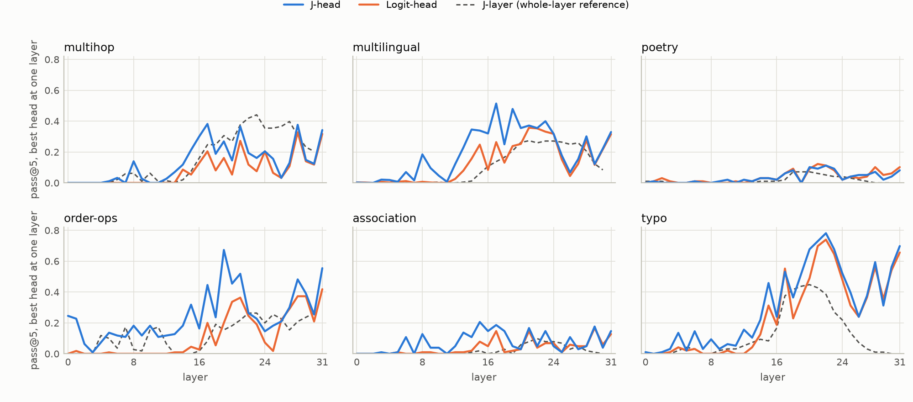
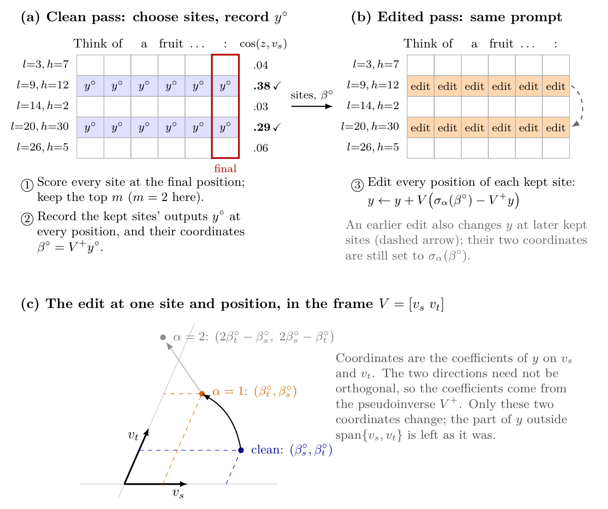
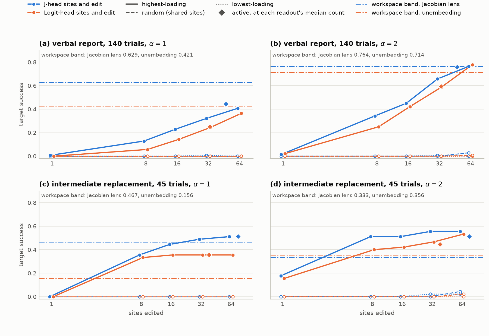
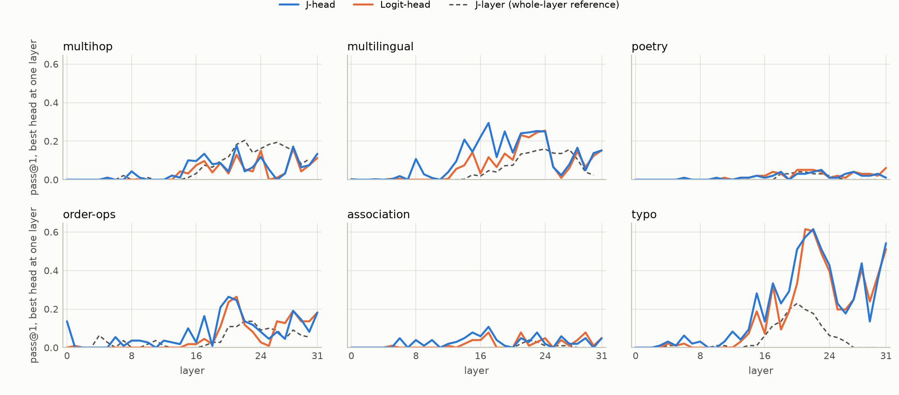
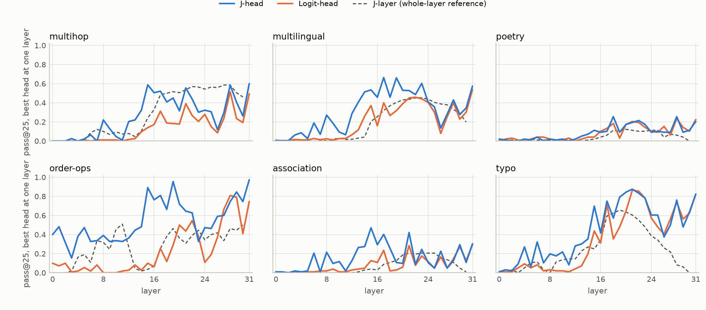
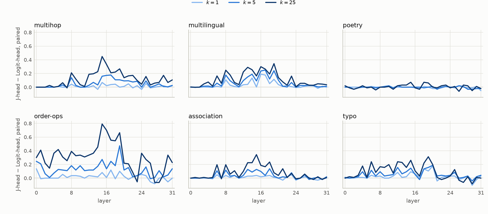
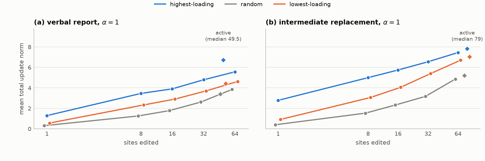

# Reading Attention Heads Through the Jacobian Lens

**Filippo Merlo**

October 12, 2026

## Abstract

Attention heads add their outputs into a shared residual stream, so readouts of the stream can show what a layer represents but not which head wrote it. A head's output can be decoded directly through the unembedding (the per-head logit lens), but this leaves out the computation of the layers that follow. We introduce Head-JLens, which adapts the Jacobian lens of Gurnee et al. (2026) to attention heads: it fits one map per layer at the concatenated head outputs, before they are summed, and reads each head through the model's remaining computation. In Llama-3.1-8B-Instruct, we compare Head-JLens with the per-head logit lens in two experiments. The first tests whether individual heads reveal intermediate words that the model plausibly represents but the prompt never states, such as the bridge entity of a two-hop question. Head-JLens ranks them higher than the per-head logit lens at most layers on five of six evaluation sets. The second uses each readout to select heads and edit them to carry a target token instead of a source token, either to change the model's answer or to replace a two-hop intermediate so that the final answer changes with it. Head-JLens edits succeed more often than per-head logit-lens edits on both tasks and use smaller updates, while editing random heads or the heads least aligned with the source almost never changes the answer. Reading each head through the computation that follows it thus makes its output easier to interpret and a better guide for where and how to edit the model.

## 1 Introduction

We introduce Head-JLens to read individual attention-head outputs through the model's remaining computation and use those readouts to guide activation edits. We compare it with direct per-head decoding and the original Jacobian lens of Gurnee et al. (2026) in two experiments: one measures recovery of annotated intermediate tokens, and the other tests whether edits at selected head sites redirect the model's next token.

Consider the prompt `Fact: The capital of the country where Lyon is located is`. To answer *Paris*, the model must pass through a step that the text never states: Lyon is in *France*. Residual-stream readouts, such as the logit lens and the Jacobian lens, can show that *France* is represented at a layer, but not which component wrote it, because every head's output has already been added into the stream. Head-JLens reads each head's output before that sum, so it scores *France* separately for every head.

The reading experiment asks whether some head ranks intermediates like *France* near the top of its readout. The intervention experiment edits the heads that carry *France* most strongly so that they point toward *Italy*, and checks whether the model then answers *Rome*.

### From the residual stream to individual heads

Head-JLens adapts the Jacobian lens of Gurnee et al. (2026) to attention heads. The idea is to read a head’s output through the computation that comes after it. We estimate how a small change to the head’s output changes the model’s last layer, average this effect over many texts, and use the resulting map to turn the head’s output into scores over the vocabulary. We call this map a *transport*. The logit lens skips the transport and scores each head’s output directly; the original Jacobian lens applies a transport to the output of a whole layer.

We fit the transport at the point where each head’s output is still separate from the others, before they are mixed into the residual stream. One map per layer then gives every head its own readout. For the Lyon prompt, that readout tells us how strongly each head’s output points to *France*.

### Validation design

The reading experiment compares three readouts: Head-JLens (J-head), the per-head logit lens (Logit-head), and the layer-output Jacobian lens (J-layer). J-head and Logit-head read the same head sites; J-layer reads block outputs. The intervention experiments edit heads selected by how strongly they load on the source token. They use the coordinate swap of Gurnee et al. (2026) on a verbal-report task and a factual-intermediate task, with site-selection and direction controls. As a layer-wide reference, the coordinate swap is applied to the residual stream over the workspace band of Gurnee et al. (2026), through the Jacobian lens or the bare unembedding (the logit lens). We evaluate Llama-3.1-8B-Instruct on adaptations of the original study’s datasets and procedures. The methods specify the anchors, fitting budgets, and intervention protocols.

## 2 Methods

All experiments use Llama-3.1-8B-Instruct (Grattafiori et al., 2024); the construction below applies to any pre-norm transformer, in which attention and MLP outputs are added to the residual stream without being normalized (Section 2.1).

A transformer’s residual stream combines the updates made by successive attention and MLP blocks. Head-JLens reads the attention update before its head contributions are combined, at the head anchor in Figure 1. The layer-output Jacobian lens reads the same layer after the MLP, at the block output. We first describe this decomposition, then explain how the fitted map turns each contribution into vocabulary scores.

```text
                         x_l
                          |
                    attention heads
                          |
             head anchor: z_l
                          |
                         W_O
                          |
                   a_l = sum_h c_l,h
                          |
             x_l ------> (+)
                          |
                       x_l^mid
                          |
                         MLP
                          |
          x_l^mid ------> (+)
                          |
       layer-output anchor: x_l+1
                          |
                   remaining blocks
                          |
                         x_L
                          |
                  final RMSNorm
                          |
                      unembedding
```

**Figure 1.** Where each readout attaches in a Llama layer. Head-JLens reads $z_l$, the concatenated head outputs before the output projection $W_O$ combines them; J-layer reads the block output $x_{l+1}$. Both are mapped to the final residual stream $x_L$ and scored through the final RMSNorm and unembedding. The head anchor has width $d_{\mathrm{src}}$; the other displayed activations have width $d_{\mathrm{model}}$.

### 2.1 Keeping the heads separate

Let $x_{l,p}\in\mathbb R^{d_{\mathrm{model}}}$ be the residual stream entering block $l$ at position $p$, and let $z_{l,p}\in\mathbb R^{d_{\mathrm{src}}}$ concatenate its attention-head outputs immediately before the output projection $W_{O,l}$. Each block has $H$ attention heads, each of width $d_{\mathrm{head}}$, so $d_{\mathrm{src}}=H d_{\mathrm{head}}$. Head $h$ occupies columns $\mathcal C_h$. Llama uses pre-norm blocks: each sublayer normalizes its own input and adds its output directly to the residual stream, which is normalized only once, by the final normalization before the unembedding. For the attention sublayer,

$$
c_{l,h,p}=W_{O,l}^{(h)}z_{l,h,p},\qquad
 a_{l,p}=\sum_h c_{l,h,p},\qquad
 x^{\mathrm{mid}}_{l,p}=x_{l,p}+a_{l,p},
$$

where $W_{O,l}^{(h)}=W_{O,l}[:,\mathcal C_h]$. Blocks are indexed from zero, and $x_{L,p}$ is the output of the last block, before final normalization.

### 2.2 Reading through the remaining computation

Gurnee et al. (2026) read a residual-stream activation through its first-order effect on the model’s output. A small change to the activation passes through the remaining transformer blocks and shifts the final residual stream at the current position and at every later one; to first order, this dependence is a Jacobian. A Jacobian from a single prompt mixes the model’s general tendency to say a concept with the particular use of that concept in that context, so they average it over prompts and positions, which gives one fixed map per layer rather than a prompt-specific Jacobian (Section 2.4 gives the positions used). We apply the same construction with the head anchor $z_l$ in place of the residual stream.

We denote the fitted map by $J_l^z$: the Jacobian of the final residual stream $x_L$ with respect to the head anchor $z_l$, averaged over prompts and positions (Section S1.2). It is a $d_{\mathrm{model}}\times d_{\mathrm{src}}$ matrix whose columns stay grouped by head, so reading one head means applying that head’s columns to its output:

$$
J_{l,h}=J_l^z[:,\mathcal C_h],\qquad
r_{l,h,p}=J_{l,h}z_{l,h,p}.
$$

Because the attention output enters the residual stream without further normalization, $r_{l,h,p}$ equals a single per-layer transport applied to the head’s residual write $c_{l,h,p}$; Section S1.1 derives this decomposition.

### 2.3 Vocabulary scoring

We turn each transported vector into vocabulary scores with the model’s own output head, treating it as if it were the final residual stream: the final RMSNorm, then the unembedding. Let $w_t$ be token $t$’s unembedding row and $g$ the gain of the final normalization, and write $q_t=g\odot w_t$. The score of token $t$ for head $h$ at layer $l$ and position $p$ is

$$
\ell_{l,h,p}[t]=\frac{q_t^\top r_{l,h,p}}{\sqrt{d_{\mathrm{model}}^{-1}\|r_{l,h,p}\|_2^2+\epsilon}}.
$$

The denominator is the normalization scale. It is positive and the same for every token, so it rescales a readout’s scores together without reordering them: sorting the vocabulary by $\ell_{l,h,p}[t]$ gives the same order as sorting by $q_t^\top r_{l,h,p}$. Token ranks (Section 3.3) are taken from this ordering. Every readout in Section 3.2 is scored the same way, with $r_{l,h,p}$ replaced by the vector that readout decodes; Logit-head, for instance, ranks tokens by $q_t^\top c_{l,h,p}$. The same vectors $q_t$ define the token directions used for the interventions in Section 4.

### 2.4 Fitting and relation to the original method

We fit Head-JLens on 1,000 WikiText-103 (Merity et al., 2017) prompts of at most 128 tokens, the corpus size of Gurnee et al. (2026, [methodological details](https://transformer-circuits.pub/2026/workspace/#app-method-details)), who draw their prompts from a pretraining-like distribution. Positions 0–15 and the final position are excluded from source and target sets. The estimator averages derivatives over source positions and sums them over target positions, at the head anchor (Section S1). The derivative target is the final layer, whereas the default lens of Gurnee et al. uses the penultimate layer. The model has 32 blocks, each with $H=32$ attention heads of width $d_{\mathrm{head}}=128$, so $d_{\mathrm{src}}=d_{\mathrm{model}}=4{,}096$; its vocabulary has 128,256 tokens.

For the layer-output Jacobian lens, we use Neuronpedia’s released matrices for Llama, fitted on 461 prompts. Their final block is omitted because its output is the derivative target. We report all fitted attention layers; the reference has a different anchor, corpus budget, and number of readouts.

## 3 Annotated-token recovery from heads

We measure the vocabulary rank of each annotated intermediate in six evaluation sets. For the Lyon example, we score the token candidates for *France* in each head’s readout. Head-JLens and direct decoding use the same head sites and candidate tokens.

### 3.1 What we look for

We use the six released evaluation files accompanying Gurnee et al. (2026): multihop (93 items), multilingual (107), poetry (98), order-ops (55), association (102), and typo (96). Each item supplies one or more annotated *intermediates*: words that the model plausibly represents on the way to its output but that are not written in the prompt. These annotations are the tokens we score. For example, the multihop prompt `Fact: The ocean on the coast of the country where Carnival is most famously celebrated is the` has the answer *Atlantic* and the annotated intermediate *Brazil*, the unstated country that links the question to its answer.

Readouts use the final prompt token, except for poetry, which uses the newline ending the couplet's first line. Some items also list the answer the model should give (e.g., *Atlantic*). The prompt ends just before it, and the answer itself is never scored. Items are scored regardless of whether the model's own answer is correct. Only the annotated intermediates are scored, and Table S1 gives examples.

### 3.2 Comparing transported and direct readouts

We compare three readouts. **J-head** decodes $J_{l,h}z_{l,h}$; **Logit-head** decodes $c_{l,h}$ directly. **J-layer** decodes $J_l^{\mathrm{out}}x_{l+1}$ as a whole-layer reference. J-head and Logit-head search the same head sites, while J-layer has only one readout per reference layer.

A *site* is one head at one layer; Llama has $32\times 32=1{,}024$. For each item and annotated intermediate, a per-layer result takes the best rank across that layer's 32 heads, and an all-layer result takes the best across all 1,024 sites. The annotation is used to choose the winning head separately for each item and intermediate; this is an oracle best-site search, not a held-out test of head localization.

### 3.3 Measuring recovery

A token’s rank is its position in the readout’s ordering of the vocabulary: rank 1 is the highest-scoring token, and rank $r$ means $r-1$ tokens score above it. Each intermediate takes the best rank among its accepted candidates. Every spelling is scored both bare and space-prefixed, since the tokenizer stores *France* and *␣France* as distinct tokens and which one a word takes depends on its position. Order-ops annotations name numbers and operations in words, so each is also expanded to a fixed list of equivalent forms, written once from the evaluation set's description (e.g., *five* → {*5*, *five*}; *multiplication* → {*\**, *times*, *multiply*, *product*, *multiplication*}), and a hit on any form counts. Multihop and order-ops retain only single-token spellings; the other sets score the first token of each spelling. Candidate sets can contain multiple token IDs, and first-token candidates can be shared by different words.

We call this oracle best-site top-$k$ coverage *pass@k*. For each item, we find each scoreable annotation's best rank across accepted token candidates and allowed sites, compute the fraction with rank at most $k$, and then average those fractions across items. We report $k\in\{1,5,25\}$. Each readout chooses its own best site. Section S2.2 gives the formal definition.

The paired difference is J-head minus Logit-head pass@k on the same items, which equals the mean over items of the per-item difference.

### 3.4 Per-layer recovery

Figure 2 reports per-layer pass@5 for each readout and evaluation set.



**Figure 2.** Llama per-layer pass@5, with the best head chosen separately for each item and intermediate. J-layer covers block outputs 0–30. Pass@1 and pass@25 appear in Figures S1–S2, and paired differences in Figure S3.

J-head has higher pass@5 point estimates than Logit-head over most layers on five of six sets, with the largest differences around layers 13–25; poetry shows no consistent difference. Figure S3 reports paired differences.

### 3.5 All-layer recovery

For the all-layer metric, each head arm searches all 1,024 sites and J-layer searches the 31 block outputs. Because each intermediate takes its best rank over that many sites, we report the strictest threshold, pass@1 (Table 1). J-head leads Logit-head on four of six sets, most clearly on multihop and order-ops; the two tie on typo, and Logit-head leads on poetry. J-layer is below both head readouts on every set, but each head arm takes the best of about 33 times as many sites, so this comparison does not separate a better readout from a larger search.

**Table 1.** Llama all-layer pass@1 and paired J-head minus Logit-head differences. J-head and Logit-head each search the same 1,024 sites; J-layer searches 31 block outputs.

| Set          | J-head | Logit-head | J-layer | Paired difference |
| ------------ | ------ | ---------- | ------- | ----------------- |
| multihop     | 0.649  | 0.505      | 0.452   | +0.143            |
| multilingual | 0.804  | 0.776      | 0.278   | +0.028            |
| poetry       | 0.296  | 0.347      | 0.041   | −0.051            |
| order-ops    | 0.764  | 0.682      | 0.409   | +0.082            |
| association  | 0.324  | 0.294      | 0.049   | +0.029            |
| typo         | 1.000  | 1.000      | 0.427   | +0.000            |

Section S2.3 gives the full rates.

### 3.6 How many heads read each intermediate

The best-site search keeps one head per intermediate. To ask how many heads read it, we count the sites, out of 1,024, at which the intermediate ranks within the top 5, and average the count as pass@k is averaged: over an item's intermediates, then over items. A readout that ranks a token highly at many heads whatever the prompt would inflate this count. We therefore also count the same candidate tokens at the same sites on a control prompt: another item from the same set whose annotations share no candidate token with the intermediate, taken from one fixed random ordering of the set. The count on the item's own prompt minus the count on its control prompt is the excess we compare.

J-head finds more heads than Logit-head on five of six sets and keeps the larger excess after the control is subtracted (Table 2); poetry is again the exception, with equal counts. J-head's control counts are also higher than Logit-head's on every set except poetry, where they are equal, so part of its count is not specific to the prompt. Control counts are near zero except on order-ops, where every prompt is an arithmetic expression and numbers and operators rank highly on unrelated prompts too. At the top 25 the excess favours J-head on all six sets; at the top 1 it favours J-head on four, with poetry and order-ops slightly favouring Logit-head (project repository, Section S4).

**Table 2.** Llama mean number of sites, of 1,024, at which an annotated intermediate ranks within the top 5, on its own prompt and on a control prompt from the same set. The paired difference is J-head minus Logit-head in the excess over control (own-prompt count minus control count), the mean over items of the per-item difference.

| Set          | J-head | J-head control | Logit-head | Logit-head control | Paired difference |
| ------------ | ------ | -------------- | ---------- | ------------------ | ----------------- |
| multihop     | 5.4    | 0.5            | 3.0        | 0.2                | +2.1              |
| multilingual | 8.5    | 0.7            | 5.2        | 0.4                | +3.0              |
| poetry       | 1.3    | 0.3            | 1.3        | 0.3                | +0.0              |
| order-ops    | 10.9   | 7.5            | 4.9        | 3.0                | +1.4              |
| association  | 2.8    | 0.3            | 1.4        | 0.2                | +1.3              |
| typo         | 14.2   | 0.5            | 11.1       | 0.2                | +2.7              |

## 4 Using head readouts to guide interventions

We test whether head readouts tell us where and how to edit the model. Each trial gives the model a prompt and a *source* concept it currently represents, names a *target* to put in its place, and edits a chosen set of heads so that they carry the target instead of the source. We then read the edited model's greedy next token. In verbal report the target is the answer itself. In intermediate replacement the target is an intermediate entity, and success is the downstream answer that entity implies. Both tasks and their prompt sets are taken from Gurnee et al. (2026). Edit directions come from Head-JLens (J-head) or from direct per-head decoding (Logit-head).

### 4.1 Two intervention tasks

**Verbal report.** The model is asked to name a member of a category, and the edit tries to change its answer. Each of 14 categories has the prompt `Think of a {category}. Answer in one word:` and an ordered list of 14 candidate words. We use the unedited model's greedy next token as the source, remove any candidate whose accepted tokens (defined below) include that source, and take the first ten remaining candidates as targets. This gives ten trials per category and 140 in total. For example, if the model answers *Apple* to the fruit prompt, the *Banana* trial succeeds when the edited model's greedy next token is accepted for *Banana*. Token-level matching also handles answers that are only the first token of a word.

In one category, *river*, Llama's clean next token is an opening quotation mark and matches no candidate. The first ten listed candidates are therefore retained as targets, and those ten trials swap out the quotation mark rather than a river name.

**Factual intermediate replacement.** The released task supplies 90 two-hop prompts, each with an intermediate, a replacement intermediate, and their respective downstream answers. For example, in the prompt `Fact: The capital of the country where Lyon is located is`, the edit acts on the intermediate (source *France*, target *Italy*), but success is scored on the downstream answer: the trial succeeds when *Rome* replaces *Paris* as the greedy next token. We retain the 45 Llama prompts whose clean greedy token matches the annotated original answer.

Both tasks score one token: the edited model's greedy next token at the last prompt position. No longer answer is generated. The token counts as a success if it is an accepted token for the scored word, meaning the first token of the word spelled with or without a leading space (for *Banana*, ` Banana` and `Ban`). Because only first tokens are compared, different words can share an accepted token; on Llama's tokenizer, bare *Lime* and *Lemon* both begin with `L`. Intermediate replacement likewise does not check whether the original and replacement answers share an accepted token. The edit moves each concept along a single token, the first token of its space-prefixed spelling (` Banana`), except that the verbal-report source is the model's actual greedy token. Prompts are given as raw text, without a chat template.

All conditions and direction arms share the same 185 Llama trials.

### 4.2 Changing the activation in lens coordinates

This intervention exchanges a source token's coordinate with a target token's coordinate in a head's output space. A head site is one attention head $(l,h)$, and the edit acts on its output $y=z_{l,h,p}$ at each prompt position $p$. For source and target tokens $s$ and $t$, their directions are the gain-scaled unembedding rows $q_s=g\odot w_s$ and $q_t=g\odot w_t$ (Section 2.3), pulled back through the head's transport:

$$
v_{s,l,h}=J_{l,h}^{\top}q_s,\qquad
v_{t,l,h}=J_{l,h}^{\top}q_t,\qquad
V=[v_{s,l,h}\;v_{t,l,h}].
$$

Figure 3 illustrates the procedure. We first run the model on the prompt without any edit, the clean pass, and use it for two things. It chooses which head sites to edit, using only their outputs at the final prompt position. It also records each chosen site's output $y^\circ$ at every prompt position. Its coordinates in the two-direction frame are $\beta^\circ=V^+y^\circ$, where $V^+$ is the pseudoinverse. We then run the model on the same prompt again and edit each chosen site at every prompt position, not only the final one:

$$
y\leftarrow y+V\big(\sigma_\alpha(\beta^\circ)-V^+y\big),\qquad
\sigma_\alpha(\beta)=\beta+\alpha\big(\sigma(\beta)-\beta\big),
$$

where $\sigma$ exchanges the two coordinates. When $V$ has full column rank, the update removes the activation's current coordinates and replaces them with $\sigma_\alpha(\beta^\circ)$, computed from the clean coordinates. Thus, if an earlier edit has changed $y$, the later site's two coordinates are still clamped to the values specified by its clean pass. The component orthogonal to $\operatorname{span}\{v_{s,l,h},v_{t,l,h}\}$ is unchanged.

At $\alpha=1$, this is the coordinate swap of Gurnee et al. (2026, [Methods](https://transformer-circuits.pub/2026/workspace/#methods-technical-details)), clamped to clean-pass coordinates as in their [reasoning experiments](https://transformer-circuits.pub/2026/workspace/#ws-reasoning). We use this as the primary strength and also report $\alpha=2$, which overshoots the swap. For Logit-head directions, $W_{O,l}^{(h)}$ replaces $J_{l,h}$; the edit is otherwise the same (Section S3.5). The directions retain their original norms. Section S3.1 covers rank-deficient frames and the alternative that swaps the current, rather than clean, coordinates.



**Figure 3.** The coordinate swap. (a) The prompt is run once without edits. Each head site's source loading at the final position selects the $m$ sites to edit, and their outputs $y^\circ$ at every position give the clean coordinates $\beta^\circ$. (b) The prompt is run again, and each selected site is edited at every position. An edit at an earlier layer changes the activation at later selected sites (dashed arrow); their two coordinates are still set to $\sigma_\alpha(\beta^\circ)$. (c) At one site and position, the coordinates on the source and target directions are exchanged ($\alpha=1$) or pushed past the exchange ($\alpha=2$); the component outside their span is unchanged. Sites, scores and tokens are illustrative.

### 4.3 Where we apply the edit

We call $\cos(z_{l,h},v_{s,l,h})$ a site’s *source loading*; it measures how closely the head’s output points along the source direction. For each trial and $m\in\{1,8,16,32,64\}$, we select the $m$ sites with highest source loading and compare them with the $m$ lowest-loading sites and a uniform random set of the same size. Sets are nested within each rule: the top 16 sites contain the top 8, and each trial’s random sets are the first $m$ sites of one fixed shuffle, so raising $m$ only adds sites. We use $m$ for edited-site count to distinguish it from the top-$k$ vocabulary threshold.

The active-site condition lets each trial set its own count. It keeps the sites whose output points along the source direction more than along the directions of unrelated tokens. At each site, we compute the same cosine for 256 random vocabulary tokens, with each token’s direction in place of $v_{s,l,h}$. The site is considered active when its source loading exceeds the 99th percentile of these 256 values. The 256 tokens are drawn once and reused for every prompt and trial. The selected-count medians are 49.5 (J-head) and 32 (Logit-head) for verbal report, and 79 and 37 for intermediate replacement; random and lowest-loading controls match each trial’s count (Section S3.2).

Each readout selects sites by its own source loading, and random sites are shared between readouts. Each swap also has a random-direction control: a random update matched to the swap's local norm at the same sites. As a reference, we apply the same clamped swap to the whole residual stream instead of to individual heads. It runs at every position of block outputs 12–28, the workspace band of Gurnee et al. (2026, [workspace layers](https://transformer-circuits.pub/2026/workspace/#struct-layers)), their 38–92% depth range mapped onto Llama. Directions come from the layer-output Jacobian lens or the bare unembedding.

Site controls match the number of edited sites, while update sizes differ. At $\alpha=1$, J-head's selected-site updates are larger than its lowest-loading-site updates, which are larger than its random-site updates, at every count (Table S4). At every fixed count, Logit-head's selected sites receive larger swaps than J-head's (Table 3 gives the 64-site norms); at the active sets the order reverses (J-head 6.7 against Logit-head 5.6 on verbal report, 7.8 against 7.2 on intermediate replacement), where J-head's active sets are larger. Section S3.3 reports J-head's total update norms, and the project repository (Section S4) gives them for both readouts at every count. Because we did not equalize these norms, a success gap between site rules cannot be attributed to site selection alone.

### 4.4 Coordinate-swap results

Figure 4 and Table 3 report target-token success by edited-site count, task, coordinate-swap strength and readout; Table S6 gives the corresponding rates and paired J-head minus Logit-head differences on the same trials.



**Figure 4.** Llama target-token success as the number of edited head sites increases. Blue is J-head and orange is Logit-head. Solid lines show each readout's highest-loading sites, the main comparison. Dashed and dotted lines show random and lowest-loading sites; diamonds show active sets at their median site counts. Horizontal dash-dotted lines are references that swap the whole residual stream at block outputs 12–28, through the Jacobian lens (blue) or the bare unembedding (orange). The top row reports verbal report (140 trials), the bottom row intermediate replacement (45 trials); columns give swap strengths $\alpha=1$ and $\alpha=2$. The controls remain near zero at both strengths. Table 3 gives the counts and the 64-site update norms; rates at every count are in the project repository (Section S4), and J-head update norms at every count in Table S4.

**Table 3.** Llama target-token success under the coordinate swap, J-head / Logit-head. Each readout's swap runs at its own highest-loading, lowest-loading or active sites. Random sites are shared; random direction is a same-norm random update at each readout's own 64 sites. Layer-wide entries use the Jacobian lens / the bare unembedding at block outputs 12–28. Update norms are mean total head-level norms (Section S3.3).

| Sites | Verbal report, $\alpha=1$ (of 140) | Verbal report, $\alpha=2$ (of 140) | Intermediate replacement, $\alpha=1$ (of 45) | Intermediate replacement, $\alpha=2$ (of 45) |
| --- | ---: | ---: | ---: | ---: |
| 1 | 1 / 0 | 2 / 3 | 0 / 0 | 8 / 7 |
| 8 | 18 / 8 | 48 / 35 | 16 / 15 | 23 / 18 |
| 16 | 32 / 20 | 63 / 59 | 20 / 16 | 23 / 19 |
| 32 | 45 / 34 | 92 / 82 | 22 / 16 | 25 / 21 |
| 64 | 57 / 51 | 107 / 109 | 23 / 16 | 25 / 24 |
| active | 62 / 35 | 106 / 83 | 23 / 16 | 23 / 20 |
| *Controls and reference* | | | | |
| 64 random sites | 0 / 0 | 4 / 1 | 0 / 0 | 2 / 1 |
| 64 lowest-loading | 0 / 0 | 0 / 0 | 0 / 0 | 1 / 0 |
| 64, random direction | 0 / 0 | 1 / 1 | 0 / 0 | 0 / 0 |
| layer-wide | 88 / 59 | 107 / 100 | 21 / 7 | 15 / 16 |
| update norm, 64 sites | 5.6 / 10.1 | 11.1 / 20.2 | 7.4 / 9.2 | 14.8 / 18.3 |

**J-head against Logit-head.** At $\alpha=1$, J-head succeeds more often than Logit-head at every count from eight selected sites upward and at the active sets, on both tasks. At these fixed counts it also uses smaller updates: Logit-head's swaps are 1.7–1.8 times J-head's update norm on verbal report and 1.1–1.2 times on intermediate replacement. At $\alpha=2$ the ordering holds except at 64 verbal-report sites, where the two are about equal.

**Site count and controls.** At $\alpha=1$ a single edited site almost never succeeds; success grows with the number of sites and, on intermediate replacement, levels off beyond about 16. J-head's active sets succeed about as often as its 64 highest-loading sites. Random sites, lowest-loading sites and matched-norm random directions stay near zero for both readouts at every count and strength (Section S3.5).

**Layer-wide reference.** At $\alpha=1$, swapping the whole residual stream through the Jacobian lens succeeds more often than any head-level edit on verbal report and about as often as the best ones on intermediate replacement. At $\alpha=2$, the 64 highest-loading J-head sites match it on verbal report and exceed it on intermediate replacement. The Jacobian-lens residual swap also outperforms the bare-unembedding swap at $\alpha=1$ on both tasks (Section S3.4), consistent with the finding of Gurnee et al. (2026) that the Jacobian lens reads intermediate concepts better than the logit lens.

## 5 Related work

**Reading hidden states in the vocabulary.** The logit lens decodes an intermediate residual-stream state by applying the model's final normalization and unembedding to it (nostalgebraist, 2020). The tuned lens instead trains an affine map for each layer so that the decoded distribution matches the model's final prediction (Belrose et al., 2023). The Jacobian lens of Gurnee et al. (2026) needs no trained probe: it averages, over many texts, how a small change to a residual-stream state changes the final layer, and uses this average as the map into the vocabulary. All three read the residual stream, where the contributions of all earlier components have already been summed. Head-JLens keeps the Jacobian-lens construction but places the anchor at the concatenated head outputs, so each head is read through its own columns of the fitted map. We compare it with the logit lens and the Jacobian lens; a trained tuned lens is not included.

**Reading individual heads.** The output of an attention layer is a sum of per-head terms, so each head's contribution can be studied separately (Elhage et al., 2021). Circuit analyses often project a head's output directly onto the unembedding to see which tokens it promotes (e.g., Wang et al., 2023); our Logit-head readout is this projection. Other work describes what a head can write regardless of input by projecting its weight matrices into the vocabulary (Dar et al., 2023). Gurnee et al. (2026, [component analysis](https://transformer-circuits.pub/2026/workspace/#app-component-interp)) do the same through the Jacobian lens. Head-JLens instead reads the output a head actually produces on a given prompt, and it includes the effect of the layers that follow the head, which the direct projection leaves out.

**Latent intermediate steps.** Two-hop prompts such as the Lyon example require an intermediate that the text never states. Attribution graphs trace such steps through learned replacement features, finding for example an internal *Texas* step on a prompt about the capital of the state containing Dallas (Lindsey et al., 2025). Head-JLens asks which heads' transported outputs rank an annotated intermediate highly on a given prompt, without training a replacement model.

**Editing activations.** Activation steering changes model behavior by adding a direction to hidden states (Turner et al., 2023). Inference-time intervention applies such shifts to a small set of attention heads chosen with linear probes (Li et al., 2023). We use the coordinate swap of Gurnee et al. (2026), which exchanges a source token's coordinate with a target token's coordinate, and we choose the heads to edit by how strongly their readout loads on the source token.

## 6 Conclusion

We introduced Head-JLens, which moves the anchor of the Jacobian lens from the residual stream to the concatenated outputs of attention heads, so that one fitted map per layer gives every head its own vocabulary readout through the model's remaining computation. In Llama-3.1-8B-Instruct, it ranks annotated intermediate tokens higher than direct per-head decoding at most layers on five of six evaluation sets, with poetry the exception. Used to choose which heads to edit and along which directions, its readouts steer the model to a target answer more often than direct decoding's at the unscaled swap, from eight edited heads upward and with smaller updates. Count-matched control heads and random directions almost never succeed.

## Limitations

We study one model, Llama-3.1-8B-Instruct, with evaluation sets and intervention tasks adapted from Gurnee et al. (2026); other models and tasks may behave differently. The legibility metric chooses the best head for each item using the annotated token itself, so it shows that an intermediate is readable from some head, not that the lens identifies that head without knowing the token. The all-layer comparison with J-layer does not separate readout quality from search size, since each head readout takes the best of about 33 times as many sites. The site controls match the number of edited sites but not the size of the edit, so a success gap between site rules cannot be attributed to site selection alone. Finally, we compare Head-JLens with the logit lens and the Jacobian lens, but not with a trained tuned lens.

## References

Belrose, N., et al. (2023). [Eliciting Latent Predictions from Transformers with the Tuned Lens](https://arxiv.org/abs/2303.08112). arXiv:2303.08112.

Dar, G., Geva, M., Gupta, A., Berant, J. (2023). [Analyzing Transformers in Embedding Space](https://arxiv.org/abs/2209.02535). ACL 2023. arXiv:2209.02535.

Elhage, N., et al. (2021). [A Mathematical Framework for Transformer Circuits](https://transformer-circuits.pub/2021/framework/index.html). Transformer Circuits Thread.

Grattafiori, A., Dubey, A., et al. (2024). [The Llama 3 Herd of Models](https://arxiv.org/abs/2407.21783). arXiv:2407.21783.

Gurnee, W., Sofroniew, N., Pearce, A., et al. (2026). [Verbalizable Representations Form a Global Workspace in Language Models](https://transformer-circuits.pub/2026/workspace/index.html). Transformer Circuits Thread.

Li, K., Patel, O., Viégas, F., Pfister, H., Wattenberg, M. (2023). [Inference-Time Intervention: Eliciting Truthful Answers from a Language Model](https://arxiv.org/abs/2306.03341). NeurIPS 2023. arXiv:2306.03341.

Lindsey, J., et al. (2025). [On the Biology of a Large Language Model](https://transformer-circuits.pub/2025/attribution-graphs/biology.html). Transformer Circuits Thread.

Merity, S., Xiong, C., Bradbury, J., Socher, R. (2017). [Pointer Sentinel Mixture Models](https://arxiv.org/abs/1609.07843). ICLR 2017. arXiv:1609.07843.

nostalgebraist (2020). [interpreting GPT: the logit lens](https://www.lesswrong.com/posts/AcKRB8wDpdaN6v6ru/interpreting-gpt-the-logit-lens). LessWrong.

Turner, A. M., et al. (2023). [Steering Language Models With Activation Engineering](https://arxiv.org/abs/2308.10248). arXiv:2308.10248.

Wang, K., Variengien, A., Conmy, A., Shlegeris, B., Steinhardt, J. (2023). [Interpretability in the Wild: a Circuit for Indirect Object Identification in GPT-2 Small](https://arxiv.org/abs/2211.00593). ICLR 2023. arXiv:2211.00593.

---

# Supplementary material

## S1 Fitting and scoring

### S1.1 Anchor locations and the per-layer transport

The pre-norm construction uses the input to the attention output projection as its head anchor (Figure 1). The whole-layer reference uses the block output. The final derivative target is the last block output before the model’s final RMSNorm.

Because the attention output is added to the residual stream with no normalization after the addition (Section 2.1), the head anchor reaches the rest of the model only through $x_l^{\mathrm{mid}}=x_l+W_{O,l}z_l$. Let $J_l^{\mathrm{attn}}$ be the transport from $x_l^{\mathrm{mid}}$, fitted with the same estimator, prompts and positions as $J_l^z$. By the chain rule, and because $W_{O,l}$ does not depend on the input, the corpus-averaged maps satisfy

$$
J_l^z=J_l^{\mathrm{attn}}W_{O,l},\qquad
r_{l,h,p}=J_l^{\mathrm{attn}}c_{l,h,p},\qquad
\sum_h r_{l,h,p}=J_l^{\mathrm{attn}}a_{l,p}=J_l^z z_{l,p}.
$$

Head-JLens is thus the Jacobian lens anchored at $x_l^{\mathrm{mid}}$, applied to one head’s residual write at a time. Every head in a layer passes through the same map, so J-head and Logit-head (Section 3.2) differ only in whether that map is applied. The map has no centering or fitted intercept, so the per-head transported vectors $r_{l,h,p}$ sum exactly to the transported attention output.

### S1.2 Estimator and fitting procedure

The fitted matrix averages over prompts and valid source positions, **summing** derivatives over valid target positions. For $N$ prompts and valid position set $P_i$ in prompt $i$,

$$
\widehat J_l^z=
\frac1N\sum_{i=1}^{N}\frac1{|P_i|}
\sum_{p\in P_i}\sum_{q\in P_i}
\frac{\partial x^{(i)}_{L,q}}{\partial z^{(i)}_{l,p}}
\in\mathbb R^{d_{\mathrm{model}}\times d_{\mathrm{src}}}.
$$

Causality makes terms with $q<p$ zero. There is no additional normalization by the number of target positions: this is an average source-position effect on the sum of final activations, not an average of same-position Jacobians. We write $J_l^z$ for this fitted matrix throughout.

For a prompt of length $T_i$, the valid position set is $P_i=\{16,\ldots,T_i-2\}$. The fit uses 1,000 WikiText-103 training passages, tokenized to at most 128 positions and weighted equally. The fitting budget was fixed rather than determined by a convergence criterion. Sampling and hardware details are in the project repository (Section S4).

## S2 Legibility evaluation details

### S2.1 Examples and candidate coverage

**Table S1.** Evaluation examples and Llama item counts. Prompts are abridged; ↵ denotes a newline. Every Llama intermediate is scoreable under the stated candidate rules.

| Set          | Items | Prompt                                                                                               | Annotated intermediates       |
| ------------ | ----: | ---------------------------------------------------------------------------------------------------- | ----------------------------- |
| multihop     | 93    | `Fact: The ocean on the coast of the country where Carnival is most famously celebrated is the`      | Brazil                        |
| multilingual | 107   | `Lo opuesto de "grande" es "`                                                                        | Spanish, opposite, big, small |
| poetry       | 98    | `A rhyming couplet:`↵`… his final, rattling breath,`↵`And closed his eyes to greet the face of`      | death                         |
| order-ops    | 55    | `(2 + 3) * 4 =`                                                                                      | 5, multiplication             |
| association  | 102   | `She kept his coffee mug on the counter, washed it every morning and put it back, though no one had used it in eleven months.` | grief                         |
| typo         | 96    | `The course required that every student learn a second langauge`                                     | language                      |

What counts as an intermediate depends on the set: the unstated bridge entity (multihop); English words for the prompt’s language, the relation, the source word, and the answer (multilingual); the word the next line must rhyme on, read before that line begins (poetry); the partial result and the operation still to apply (order-ops); a concept the text implies but never names (association); and the correct spelling of a misspelled word (typo). The six sets contain 103, 428, 98, 110, 102, and 96 annotated intermediates in Table S1’s order. Candidate sets deduplicate token IDs across bare and space-prefixed spellings. For order-ops, a fixed synonym mapping associates numbers with digit and English-word forms and operations with symbols and common names; for example, multiplication maps to `*`, multiplication, times, multiply, and product. The mapping is shared by all arms; sensitivity to alternate synonym sets or their size was not evaluated.

Multihop and order-ops drop spellings that require more than one token. This prevents a bare-space token from becoming the candidate for a space-prefixed numeral on Llama. Other sets retain first-token proxies, which can match shared prefixes without recovering the full annotated word. We did not systematically assess semantic specificity or prefix collisions.

### S2.2 Aggregation

For item $i$ with scoreable intermediate set $I_i$, accepted token candidates $T_i(c)$ for intermediate $c$, and site set $S$, define

$$
\operatorname{rank}_{i,S}(c)=\min_{s\in S}\min_{t\in T_i(c)}\operatorname{rank}_{i,s}(t),
\qquad
\operatorname{pass@}k(S)=\frac1N\sum_{i=1}^N\frac1{|I_i|}
\sum_{c\in I_i}\mathbf1[\operatorname{rank}_{i,S}(c)\le k],
$$

where $\operatorname{rank}_{i,s}(t)$ is token $t$'s rank in the readout at site $s$ and $N$ is the number of items in the set. The minimum rank is taken independently within each arm. A per-layer head value searches $H$ candidates; an all-layer value searches every fitted $(l,h)$ pair. The layer-output reference searches $L-1$ outputs. The paired difference $\operatorname{pass@}k(S)_{\text{J-head}}-\operatorname{pass@}k(S)_{\text{Logit-head}}$ is the mean over the same $N$ items of the per-item difference.

### S2.3 Complete rates

Tables S2 and S3 report all-layer pass@5 and pass@25 in the format of Table 1, and Figures S1–S2 report per-layer pass@1 and pass@25 in the format of Figure 2.

**Table S2.** Llama all-layer pass@5 and paired J-head minus Logit-head differences. Sites searched as in Table 1.

| Set          | J-head | Logit-head | J-layer | Paired difference |
| ------------ | ------ | ---------- | ------- | ----------------- |
| multihop     | 0.916  | 0.799      | 0.735   | +0.116            |
| multilingual | 0.890  | 0.881      | 0.463   | +0.009            |
| poetry       | 0.449  | 0.541      | 0.082   | −0.092            |
| order-ops    | 0.982  | 0.882      | 0.655   | +0.100            |
| association  | 0.627  | 0.559      | 0.147   | +0.069            |
| typo         | 1.000  | 1.000      | 0.688   | +0.000            |

**Table S3.** Llama all-layer pass@25 and paired J-head minus Logit-head differences. Sites searched as in Table 1.

| Set          | J-head | Logit-head | J-layer | Paired difference |
| ------------ | ------ | ---------- | ------- | ----------------- |
| multihop     | 0.989  | 0.946      | 0.842   | +0.043            |
| multilingual | 0.960  | 0.960      | 0.624   | +0.000            |
| poetry       | 0.816  | 0.827      | 0.214   | −0.010            |
| order-ops    | 1.000  | 0.991      | 0.909   | +0.009            |
| association  | 0.843  | 0.863      | 0.284   | −0.020            |
| typo         | 1.000  | 1.000      | 0.865   | +0.000            |



**Figure S1.** Llama per-layer pass@1, with the same aggregation as Figure 2.



**Figure S2.** Llama per-layer pass@25, with the same aggregation as Figure 2.



**Figure S3.** Paired J-head minus Logit-head differences by layer at $k=1$, $5$, and $25$. Each panel is one evaluation set; line shade gives the vocabulary threshold.

## S3 Intervention details and Llama reference rates

### S3.1 Frames and intervention scope

Frames contain the unnormalized pulled-back source and target vectors. No trials are excluded on the basis of frame rank or conditioning. If a frame is rank-deficient, the pseudoinverse defines minimum-norm coefficients, but the exact coefficient-exchange interpretation need not hold. Frame-conditioning sensitivity was not measured.

At a layer, selected head updates are computed from that layer’s incoming head outputs and added together. Downstream layers see the resulting changed activations. Site selection and swap coefficients both come from the clean pass (Section 4.2). Edits include the early positions excluded from fitting. The residual-stream reference similarly edits every position at each covered block output.

Recomputing the coefficients in the intervened pass instead undoes the swap across layers: an edit reaches later sites through the residual stream, where it is exchanged back at $\alpha=1$ and overshot with a factor of −3 at $\alpha=2$. With recomputed coefficients, J-head at 64 sites succeeds on 41/140 and 55/140 verbal-report trials ($\alpha=1,2$).

### S3.2 Selection and thresholding

Top and bottom sets rank source-direction cosine on clean activations at the final prompt position. Random sets are nested subsets of one uniform random ordering per trial, shared across strengths and direction arms. Results therefore use one random set per trial and count rather than averaging over repeated selections.

For active-site selection, we sample 256 vocabulary tokens uniformly without replacement, including punctuation and special tokens. At each site and prompt, we compute the cosine between the clean head output and each sampled token’s direction. A site is considered active when its source loading strictly exceeds the empirical 99th percentile of these cosines. The vocabulary draw is shared, but the cutoff depends on both site and prompt. Verbal report has 14 distinct clean activation/threshold maps, shared by each category’s ten targets.

Observed Llama active counts range from 33 to 72 for verbal report and from 32 to 119 for intermediate replacement under J-head, and from 18 to 50 and from 22 to 65 under Logit-head. Random and bottom controls match each trial’s count; seed and quantile sensitivity were not measured.

### S3.3 Direction control and update norms

The matched-norm control first computes the targeted swap update $\delta$ (Head-JLens or Logit-head) on the activation encountered in that control’s forward pass. It draws independent standard-Gaussian entries at each position in head coordinates, then rescales each noise vector to $\|\delta\|_2$. Zero updates remain zero. The same trial/site noise is reused across conditions and strengths. Because preceding random edits change later activations, this matches the local counterfactual swap norm along the random-control trajectory; it does not guarantee equality with the total norm of a separate Head-JLens trajectory.

For trial $i$, the total head-level update norm is

$$
D_i=\left(\sum_{(l,h)\in S_i}\sum_{p=0}^{T_i-1}
\|\delta_{i,l,h,p}\|_2^2\right)^{1/2}.
$$

It is measured in concatenated head coordinates across all prompt positions and selected layers. Tables report the arithmetic mean of $D_i$ over trials, without length normalization. It is not the norm of the net residual change, and the head-level table does not assign a comparable norm to the residual-stream reference.

**Table S4.** Llama mean total update norm at $\alpha=1$ and mean selected-site source loading, J-head, from the J-head-only run (Section S3.5). Entries are top / random / bottom; the active row uses matched counts.

| sites  | verbal report, update norm | verbal report, loading | intermediate replacement, update norm | intermediate replacement, loading    |
| ------ | ------------------------ | ---------------------- | --------------------- | ---------------------- |
| 1      | 1.3 / 0.3 / 0.6          | 0.633 / 0.011 / −0.566 | 2.8 / 0.4 / 0.9       | 0.686 / 0.042 / −0.586 |
| 8      | 3.5 / 1.3 / 2.3          | 0.506 / 0.010 / −0.436 | 5.0 / 1.5 / 3.1       | 0.553 / 0.024 / −0.452 |
| 16     | 3.9 / 1.8 / 2.9          | 0.439 / 0.009 / −0.378 | 5.7 / 2.3 / 4.1       | 0.490 / 0.020 / −0.393 |
| 32     | 4.8 / 2.6 / 3.7          | 0.368 / 0.010 / −0.310 | 6.6 / 3.2 / 5.4       | 0.415 / 0.017 / −0.332 |
| 64     | 5.6 / 3.8 / 4.6          | 0.295 / 0.009 / −0.248 | 7.5 / 4.9 / 6.7       | 0.335 / 0.014 / −0.270 |
| active | 6.7 / 3.4 / 4.4          | 0.289 / 0.010 / −0.267 | 7.8 / 5.2 / 7.0       | 0.300 / 0.014 / −0.258 |



**Figure S4.** Llama mean total update norm at $\alpha=1$ (Table S4). Active-set diamonds appear at median site counts. Site-selection rules are matched by count; update norms are not equalized.

Selected sites span multiple layers and value-sharing groups. For example, the eight highest-loading verbal-report sites span on average 6.1 layers and 6.9 (layer, key–value group) pairs; the eight highest-loading intermediate-replacement sites span 6.8 and 7.1.

### S3.4 Active-site and layer-wide rates

**Table S5.** Llama target-token success at the active-site condition and the layer-wide reference, J-head / Logit-head. Values are successes/trials; active counts vary by trial. Layer-wide entries use the Jacobian lens / the bare unembedding at the workspace band, block outputs 12–28. Figure 4 shows the other site counts and controls.

| task (trials)              | strength   | active sites  | layer-wide reference |
| -------------------------- | ---------: | ------------: | -------------------: |
| verbal report (140) | $\alpha=1$ | 62 / 35       | 88 / 59              |
| verbal report (140) | $\alpha=2$ | 106 / 83      | 107 / 100            |
| intermediate replacement (45)     | $\alpha=1$ | 23 / 16       | 21 / 7               |
| intermediate replacement (45)     | $\alpha=2$ | 23 / 20       | 15 / 16              |

**Comparison with Gurnee et al.** Scored as Gurnee et al. score theirs, the band reference reproduces their verbal-report rate. They swap in only targets outside the model's clean top 10 and count a target reaching the top 5. With the unscaled swap ($\alpha=1$) over the workspace band, 72 of our 82 such targets reach the top 5 (0.88), against 88% for Claude Sonnet 4.5. On intermediate replacement, the same reference makes the replacement answer the greedy token on 21/45 trials (0.47), against 60% over their 90 two-hop prompts and 54–70% across Claude models on their 50-prompt set. The Jacobian-lens swap outperforms the bare-unembedding swap at $\alpha=1$: the bare-unembedding swap brings 54/82 verbal-report targets into the top 5 and makes the replacement answer the greedy token on 7/45 intermediate-replacement trials. Model, lens fit, prompt format and item sets differ from theirs (Sections 2.4 and 4.1). Both strengths and the unrestricted trial sets are scored in the project repository (Section S4).

### S3.5 Logit-head coordinate swap

The Logit-head frame is $V=[W_{O,l}^{(h)\top}q_s\;\;W_{O,l}^{(h)\top}q_t]$; the swap formula, strengths, site counts, rules and scope follow Sections 4.2–4.3. Each readout selects sites against its own per-site 99th-percentile null. Random site sets and random-direction noise use the seeds of Sections S3.2–S3.3 for both readouts. The layer-wide Logit-head reference swaps along $q_s$ and $q_t$ at block outputs 12–28. Random sites, lowest-loading sites and random directions succeed on at most 4/140 verbal-report and 3/45 intermediate-replacement trials for either readout at any count. The two readouts' top-64 sets share about 24 sites on verbal report and 25 on intermediate replacement.

Table S6 gives the success rates of Table 3 with paired J-head minus Logit-head differences, in the format of Table 1.

**Table S6.** Llama coordinate-swap success rates and paired J-head minus Logit-head differences on the same trials. Each readout's swap runs at its own highest-loading or active sites, as in Table 3. Layer-wide rows use the Jacobian lens / the bare unembedding at block outputs 12–28, and their difference is Jacobian lens minus bare unembedding.

| Sites | J-head, $\alpha=1$ | Logit-head, $\alpha=1$ | Paired difference, $\alpha=1$ | J-head, $\alpha=2$ | Logit-head, $\alpha=2$ | Paired difference, $\alpha=2$ |
| --- | --- | --- | --- | --- | --- | --- |
| *Verbal report (140 trials)* | | | | | | |
| 1 | 0.007 | 0.000 | +0.007 | 0.014 | 0.021 | −0.007 |
| 8 | 0.129 | 0.057 | +0.071 | 0.343 | 0.250 | +0.093 |
| 16 | 0.229 | 0.143 | +0.086 | 0.450 | 0.421 | +0.029 |
| 32 | 0.321 | 0.243 | +0.079 | 0.657 | 0.586 | +0.071 |
| 64 | 0.407 | 0.364 | +0.043 | 0.764 | 0.779 | −0.014 |
| active | 0.443 | 0.250 | +0.193 | 0.757 | 0.593 | +0.164 |
| layer-wide | 0.629 | 0.421 | +0.207 | 0.764 | 0.714 | +0.050 |
| *Intermediate replacement (45 trials)* | | | | | | |
| 1 | 0.000 | 0.000 | +0.000 | 0.178 | 0.156 | +0.022 |
| 8 | 0.356 | 0.333 | +0.022 | 0.511 | 0.400 | +0.111 |
| 16 | 0.444 | 0.356 | +0.089 | 0.511 | 0.422 | +0.089 |
| 32 | 0.489 | 0.356 | +0.133 | 0.556 | 0.467 | +0.089 |
| 64 | 0.511 | 0.356 | +0.156 | 0.556 | 0.533 | +0.022 |
| active | 0.511 | 0.356 | +0.156 | 0.511 | 0.444 | +0.067 |
| layer-wide | 0.467 | 0.156 | +0.311 | 0.333 | 0.356 | −0.022 |

Section 4.4's results come from one run that holds both readouts. It repeats the conditions of a separate J-head-only run, which supplies Table S4 and Figure S4, in a larger forward batch. Bfloat16 differences change 16 of 7,030 J-head trial outcomes between the two runs, eight in each direction, and move 10 of 76 success counts by 1. The run also crosses selection with direction, running each readout's swap at the other readout's sites; those cells, with every update norm, are in the project repository (Section S4).

### S3.6 Source loading and readout rank

Section 4.3 selects edit sites by source loading, and Section 3 reads a concept at a site by its rank in that site's readout. Both compare the head's output with the source direction, but the readout also weighs the source against every other token, so a site can load strongly on the source while ranking other tokens above it. We therefore ask whether the sites Section 4 edits are the sites where the source reads best.

For each of the 59 distinct prompts (14 verbal report, 45 intermediate replacement), we compute the source loading and the source token's rank in the readout at every head site, at the final prompt position, each readout through its own map. The token is the one the swap moves, not the accepted-token set of Section 3. The loadings reproduce the active sets and top sets of all 185 swap trials. For each prompt, Table S7 gives the Spearman correlation over the 1,024 sites between loading and negated rank, so that agreement is positive. For each count $m$ it also gives the share of the $m$ highest-loading sites that are among the $m$ sites where the source ranks best. Sites tied in rank at that cutoff count in proportion to the places left, which is the expected share under random tie-breaking. A uniform random set of $m$ sites has expected share $m/1024$. The active column compares each prompt's active set with the same number of best-read sites.

**Table S7.** Llama agreement between source loading and the source token's readout rank at the final prompt position. Spearman correlations are medians over prompts with interquartile ranges; shares are means over prompts. The random-sites row is the expected share $m/1024$.

| Readout | Spearman, median (IQR) | $m=1$ | $m=8$ | $m=16$ | $m=32$ | $m=64$ | active |
| --- | --- | ---: | ---: | ---: | ---: | ---: | ---: |
| *Verbal report (14 prompts)* | | | | | | | |
| J-head | 0.936 (0.930–0.945) | 0.071 | 0.393 | 0.565 | 0.629 | 0.637 | 0.743 |
| Logit-head | 0.962 (0.960–0.965) | 0.161 | 0.567 | 0.710 | 0.723 | 0.751 | 0.789 |
| *Intermediate replacement (45 prompts)* | | | | | | | |
| J-head | 0.947 (0.935–0.952) | 0.124 | 0.505 | 0.615 | 0.677 | 0.702 | 0.804 |
| Logit-head | 0.960 (0.956–0.965) | 0.250 | 0.667 | 0.743 | 0.758 | 0.777 | 0.821 |
| Random sites | — | 0.001 | 0.008 | 0.016 | 0.031 | 0.063 | — |

Over all sites, loading and readout rank order the sites almost identically, for both readouts and on both tasks. Among the few sites that are edited, they agree only in part. The single highest-loading site is usually not where the source reads best. From eight sites upward, a substantial share of the selected sites is among the best-read sites, far above the random-site share, but the two sets remain distinct. The share grows with the count and is highest for the active sets. It is higher for Logit-head than for J-head at every count, and higher on intermediate replacement than on verbal report. Selecting by loading thus edits many, but not all, of the heads where the source reads best.

## S4 Code and data availability

Code, analysis records, and reproduction instructions are available in the [project repository](https://github.com/filippo-merlo/head_level_jlens). Fitted Head-JLens matrices are available in the [model repository](https://huggingface.co/fmerlo/head-level-jlens). Evaluation and intervention datasets come from the [Jacobian-lens repository](https://github.com/anthropics/jacobian-lens), and layer-output references from [Neuronpedia’s lens repository](https://huggingface.co/neuronpedia/jacobian-lens).

Raw per-site rank data are not included in the public release and require regeneration for analyses of site-level variation. The release does not fully preserve the executed source and model revisions.
